<div align="center">


# Rift Explorer Remastered

**A desktop companion for the League of Legends client.**

Customize your profile, claim rewards, manage loot and rune pages, and run champ select from your phone, all through the client's own local API.

[](https://github.com/LongpanZhou/rift-explorer-remastered/releases/latest)
[](https://github.com/LongpanZhou/rift-explorer-remastered/releases)
[](https://github.com/LongpanZhou/rift-explorer-remastered/actions/workflows/ci.yml)


[**Download**](https://github.com/LongpanZhou/rift-explorer-remastered/releases/latest) ·
[Features](#-features) ·
[Screenshots](#-screenshots) ·
[Phone champ select](#-phone-champ-select) ·
[Build from source](#-build-from-source) ·
[FAQ](#-faq)

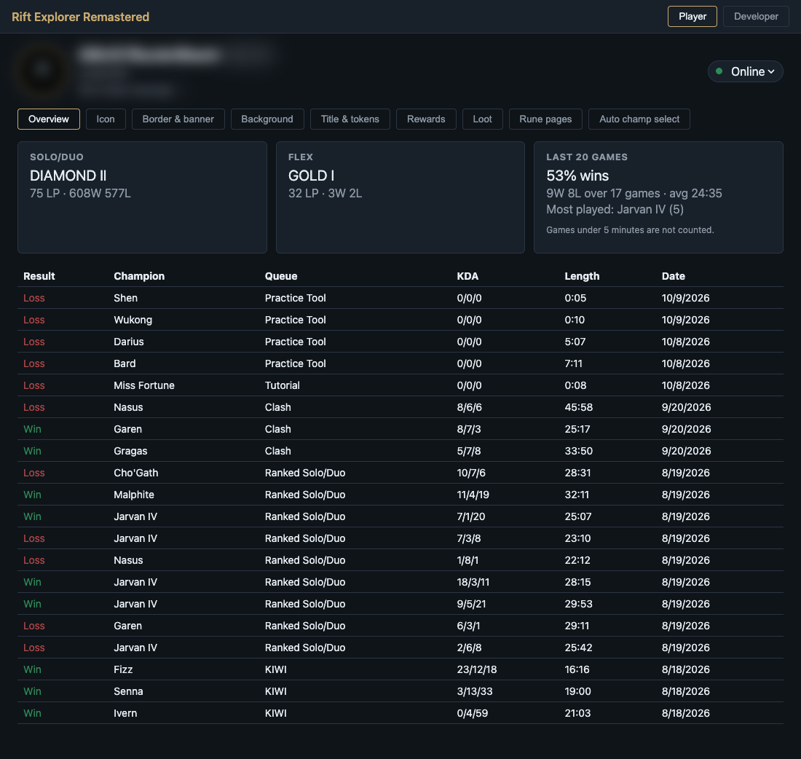

</div>

> [!NOTE]
> Rift Explorer Remastered is under active development. It is a ground-up rewrite of
> [Pupix/rift-explorer](https://github.com/Pupix/rift-explorer), the original desktop app.

---

## ✨ Features

| | Feature | What you get |
| :-: | --- | --- |
| 📊 | **Profile overview** | Level, ranked tiers (Solo/Duo and Flex), recent games with a summary. Refreshes live while the tab is open, so changes made in the client show up. |
| 🖼️ | **Icon** | Pick any summoner icon you own. |
| 🛡️ | **Border & banner** | Choose your border (ranked or prestige crest) and banner. |
| 🌄 | **Background** | Set your profile background from any skin you own. |
| 🏷️ | **Title & tokens** | Pick an owned title and up to three earned challenge tokens. |
| 💬 | **Status message** | Set your custom status and online availability. |
| 🎨 | **ASCII art status** | Turn a picture into ASCII art, with a width, a character set and an invert option, and set it as your status. Sized to fit the client's status box. Art by [ascii-image-converter](https://github.com/TheZoraiz/ascii-image-converter) (Apache-2.0). |
| 🎁 | **Rewards** | See every reward waiting to be claimed, and claim them one at a time or all at once. |
| 💎 | **Loot** | Wallet balances (RP, Blue Essence, Orange Essence) and what your loot is worth if you disenchant it. |
| 📜 | **Rune pages** | View and edit rune pages, with the client's rules checked before anything is saved. Buy extra pages with BE or RP when the store offers them. |
| ⚡ | **Auto champ select** | *Optional, off by default.* Auto-accept matches, and ban or pick from your priority lists. |
| 📱 | **Phone champ select** | Scan a QR code and run champ select from your phone over local Wi-Fi. [More below](#-phone-champ-select). |
| 🛠️ | **Developer** | Browse the client's local API as interactive Swagger docs (read-only). |

## 📸 Screenshots

> Your name, tag, level, icon and status message are blurred in every screenshot.

<table>
  <tr>
    <td align="center"><b>Overview</b><br></td>
    <td align="center"><b>Icon</b><br>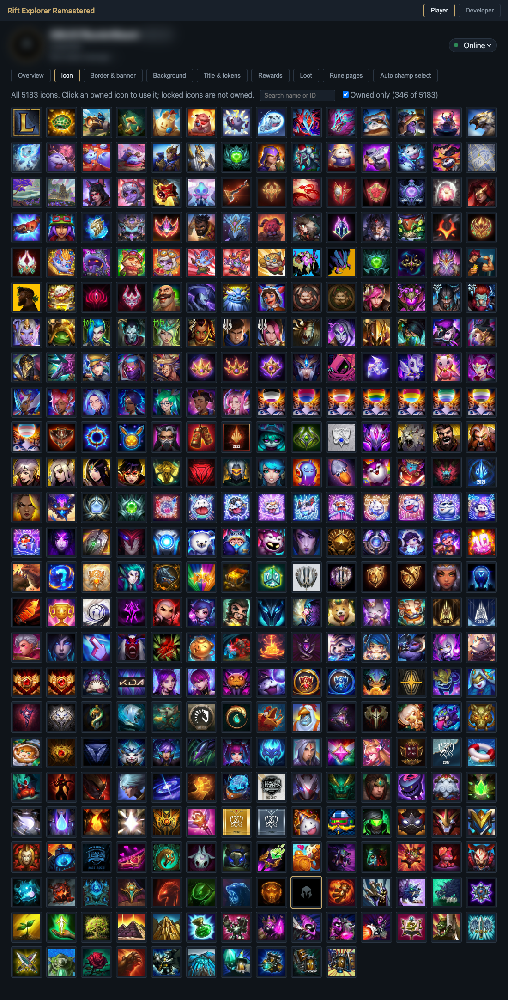</td>
  </tr>
  <tr>
    <td align="center"><b>Border & banner</b><br>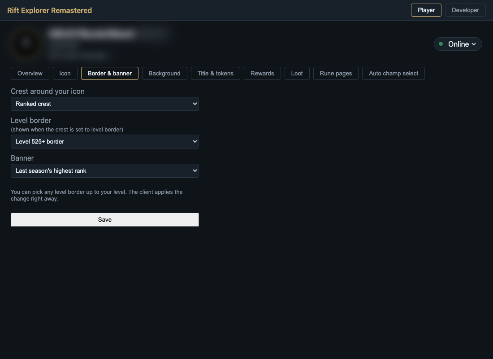</td>
    <td align="center"><b>Background</b><br>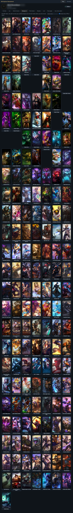</td>
  </tr>
  <tr>
    <td align="center"><b>Title & tokens</b><br>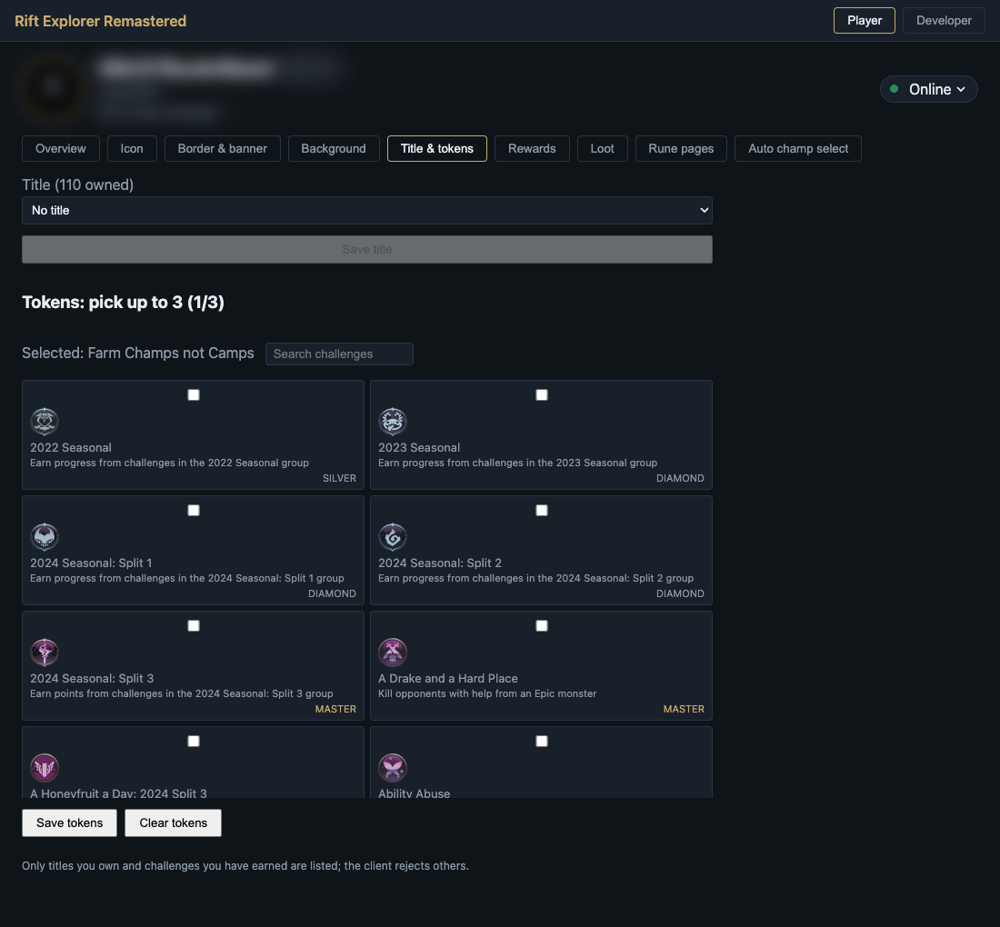</td>
    <td align="center"><b>Rewards</b><br>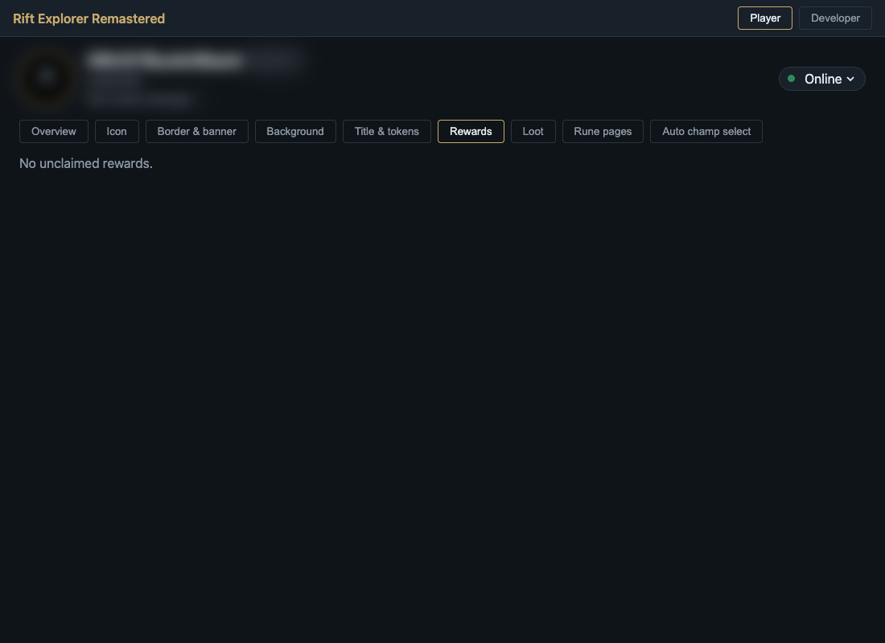</td>
  </tr>
  <tr>
    <td align="center"><b>Loot</b><br>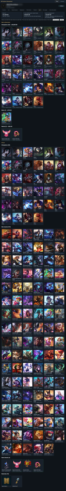</td>
    <td align="center"><b>Rune pages</b><br>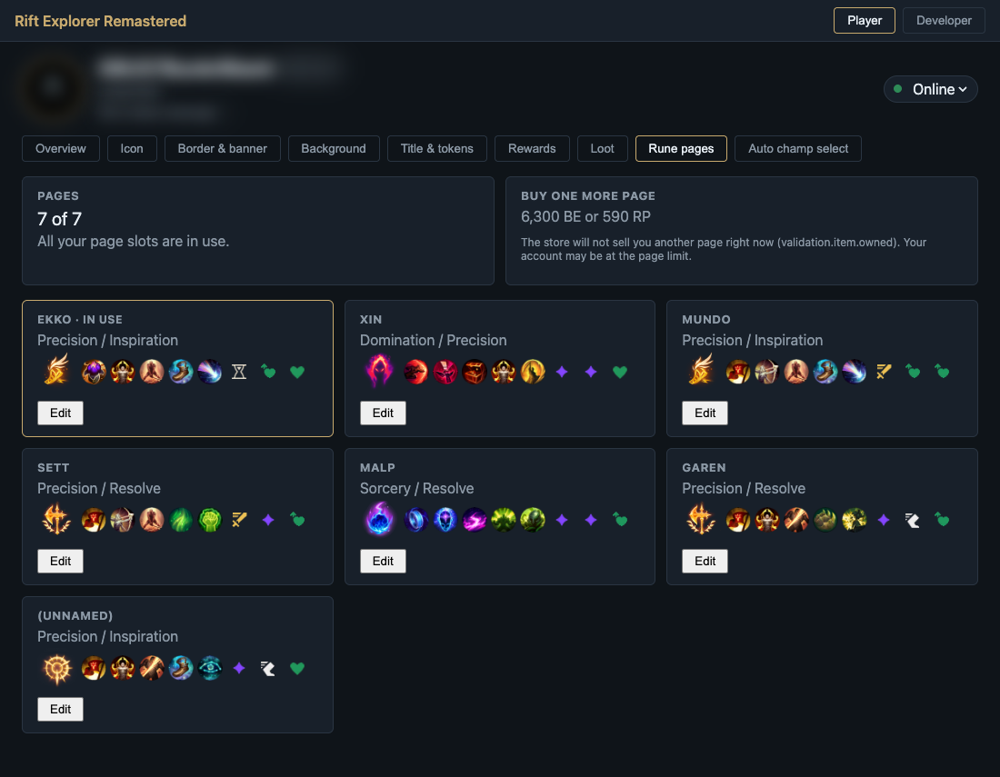</td>
  </tr>
  <tr>
    <td align="center"><b>Auto champ select</b><br>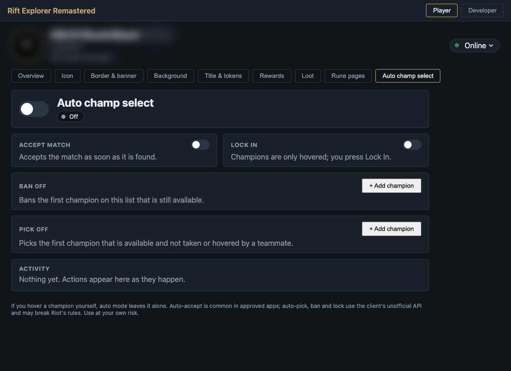</td>
    <td align="center"><b>Developer (API docs)</b><br>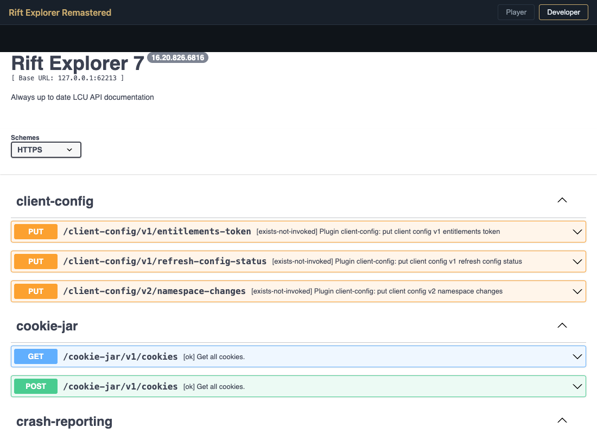</td>
  </tr>
  <tr>
    <td align="center"><b>Phone champ select (QR code)</b><br>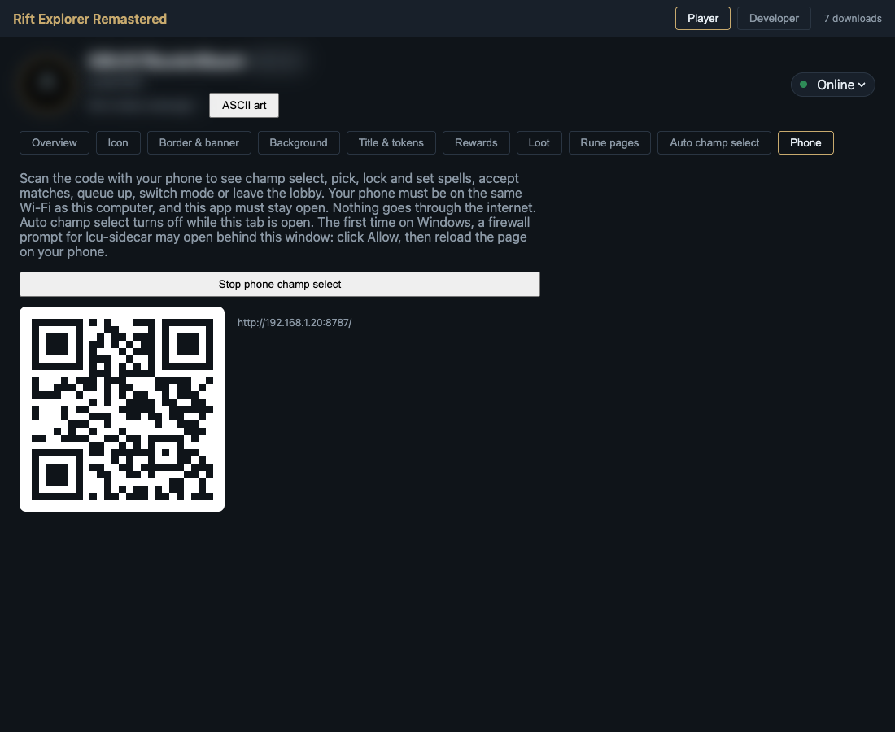</td>
    <td align="center"><b>Port 8787 already in use</b><br>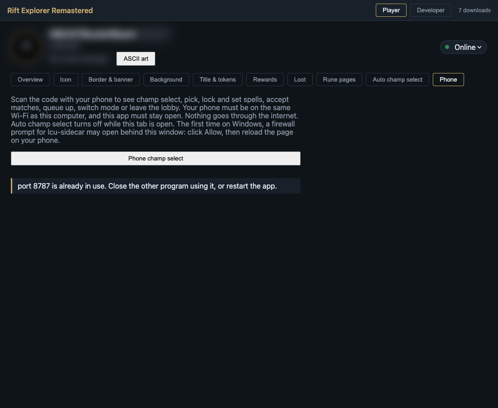</td>
  </tr>
  <tr>
    <td align="center"><b>ASCII art status</b><br>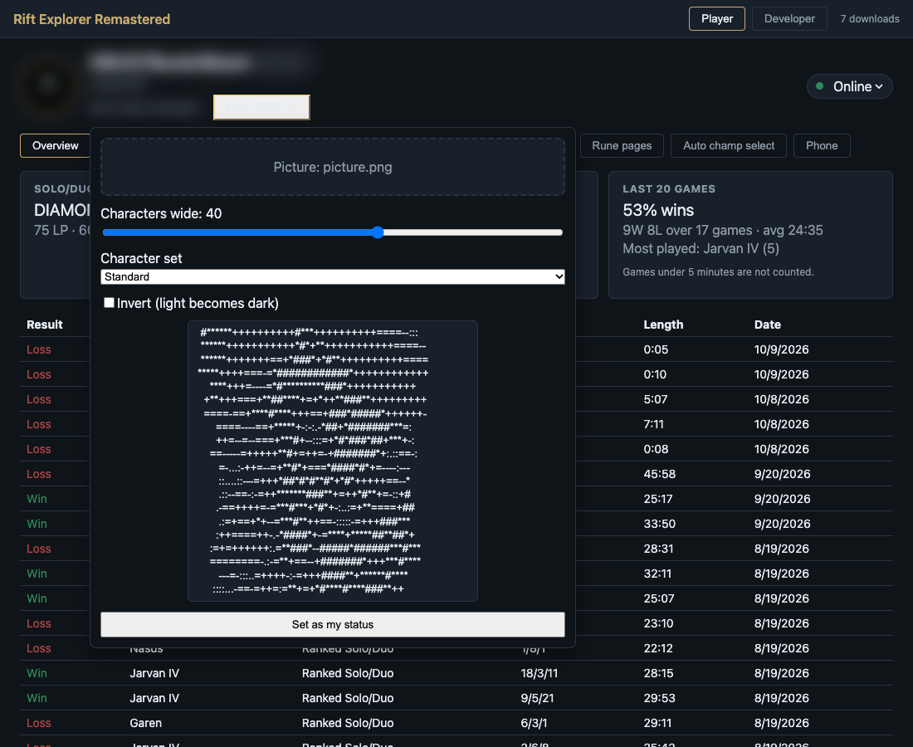</td>
    <td></td>
  </tr>
</table>

## 📱 Phone champ select

Open the **Phone** tab, scan the QR code, and your phone becomes a second screen for the client.
The phone page mirrors the in-client layout: bans across the top, both teams with their summoner
spells, a searchable champion grid, and a Lock In button.

**In champ select**

- Hover and lock picks and bans
- Set summoner spells (Summoner's Rift spells only)
- Pick, edit and switch rune pages
- Request and accept position swaps
- Browse your champion's skins with tile art, and wear one you own

**Outside champ select**

- Start and cancel the queue
- Accept or decline a found match
- Switch game mode, or leave the lobby

> [!IMPORTANT]
> Your phone must be on the **same Wi-Fi** as your computer, and the app must stay open.
> The first time on Windows, a firewall prompt for `lcu-sidecar` may open behind the app window:
> click **Allow** (private networks), then reload the page on your phone.
> The page is served from your computer on port `8787`, or the next free port up to `8796` when 8787 is taken. Nothing goes through the internet.
> Auto champ select turns off while the Phone tab is open.

## 📥 Installation

Grab the latest build for your platform from the [**Releases**](https://github.com/LongpanZhou/rift-explorer-remastered/releases/latest) page:

| Platform | File | How to run |
| --- | --- | --- |
| 🍎 macOS (Apple Silicon) | `Rift-Explorer-Remastered-<version>-macos-arm64.zip` | Unzip it and double-click the app (optionally move it to Applications first) |
| 🍎 macOS (Intel) | `Rift-Explorer-Remastered-<version>-macos-x64.zip` | Unzip it and double-click the app (optionally move it to Applications first) |
| 🪟 Windows (x64) | `Rift-Explorer-Remastered-<version>-windows-x64.exe` | One portable file, no installer. Just run it |
| 🐧 Linux (x86_64) | `Rift-Explorer-Remastered-<version>-linux-x86_64.AppImage` | `chmod +x` it, then run it |

> [!WARNING]
> Builds are **not notarized**, so macOS Gatekeeper or Windows SmartScreen may ask you to confirm
> before the app opens the first time. On macOS, if the app is blocked, open **System Settings →
> Privacy & Security** and click **Open Anyway** (or run `xattr -cr "/path/to/Rift Explorer Remastered.app"`).
> On Windows, click **More info → Run anyway**.

### Requirements

- The League of Legends client, **running and logged in**
- macOS (Apple Silicon or Intel) or Windows. On Linux the app looks for a client installed
  with Lutris's default Wine prefix (`~/Games/league-of-legends`).

## 🔨 Build from source

You need [Bun](https://bun.sh), [Rust](https://rustup.rs), and the
[Tauri prerequisites](https://tauri.app/start/prerequisites/) for your platform.

```sh
git clone https://github.com/LongpanZhou/rift-explorer-remastered.git
cd rift-explorer-remastered
bun install

bun run sidecar        # build the client-API sidecar for your platform
bun run tauri dev      # run the app in development mode
bun run tauri build    # build a release bundle
```

| Command | What it does |
| --- | --- |
| `bun test` | Run the test suite (unit, golden snapshot, render, CLI exit codes) |
| `bun run live-check` | Check the sidecar against a running, logged-in client |

### How it works

```
┌──────────────┐  invoke   ┌────────────────┐  HTTPS (local)  ┌───────────────┐
│  React UI    │ ────────▶ │  Bun sidecar   │ ──────────────▶ │ League client │
│  (Tauri 2)   │ ◀──────── │  (lcu-sidecar) │ ◀────────────── │  local API    │
└──────────────┘           └────────────────┘                 └───────────────┘
                                   ▲
                                   │ local Wi-Fi (port 8787)
                              ┌────┴─────┐
                              │  Phone   │
                              └──────────┘
```

The app reads the client's lockfile to find its local API, and a compiled Bun sidecar does
all the talking to the client. On Windows the sidecar is bundled inside the single `.exe` and
unpacked to the app's cache folder the first time it runs, always under the same name, so the
firewall permission carries over to updates.

### Releasing

Pushing a `v*` tag runs the [release workflow](.github/workflows/release.yml), which builds
macOS (Apple Silicon and Intel), Windows and Linux files and attaches them to the GitHub release.

## 🔒 Privacy

- **Your data stays on your machine.** The app only talks to the League client on your computer,
  and loads champion art from public Riot and community image sites.
- **Download count.** The top right shows how many times the release files have been downloaded,
  read from GitHub's public releases API. Nothing about you is sent.

## ❓ FAQ

<details>
<summary><b>Is this allowed by Riot?</b></summary>

The app uses the League client's local API (LCU), which Riot does not officially support for
third-party tools. Riot can change or remove parts of it at any time. Profile changes only do
what the client's own profile screen already lets you do.
</details>

<details>
<summary><b>Is auto champ select safe to use?</b></summary>

Auto champ select changes what you pick and ban in the client. Auto-accept is common in approved
apps, but auto-pick and auto-ban are a grey area. It is off by default. Use it at your own risk,
and check Riot's rules first.
</details>

<details>
<summary><b>The phone page won't load.</b></summary>

Make sure your phone and computer are on the same Wi-Fi network, the app is still open, and
your firewall allows incoming connections on port `8787` (on Windows, allow `lcu-sidecar` on
private networks, and set your Wi-Fi to a private network). Some guest or public networks block
devices from reaching each other.
</details>

<details>
<summary><b>The app says it can't find the client.</b></summary>

Start the League of Legends client and log in first. The app finds the client through its
lockfile, which only exists while the client is running.
</details>

## 🙏 Acknowledgements

- [Pupix/rift-explorer](https://github.com/Pupix/rift-explorer), the original Rift Explorer
- [Data Dragon](https://developer.riotgames.com/docs/lol#data-dragon) and
  [CommunityDragon](https://www.communitydragon.org/) for champion and skin art

---

<div align="center">
<sub>
Rift Explorer Remastered is not endorsed by Riot Games and does not reflect the views or opinions of Riot Games
or anyone officially involved in producing or managing Riot Games properties. Riot Games and all associated
properties are trademarks or registered trademarks of Riot Games, Inc.
</sub>
<br><br>
<sub>If you find this useful, consider giving it a ⭐</sub>
</div>
